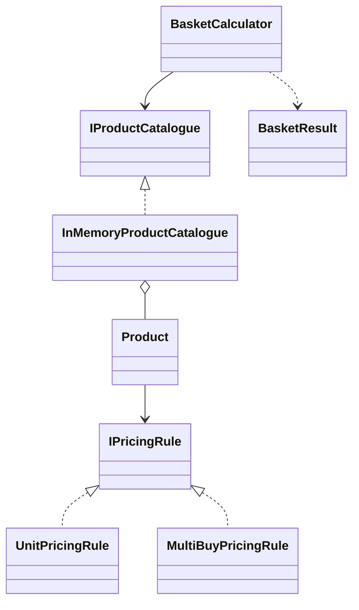

# Shopping Basket Pricing

C# (.NET 8) solution to price a basket of shopping given as a list of item names,
e.g. `["Apple", "Apple", "Banana"]`.

Prices: Apple 35p, Banana 20p, Melon 50p (buy one get one free), Lime 15p (3 for the price of 2).

## How to run

```
dotnet test
dotnet run --project src/ShoppingBasket.App -- Apple Apple Banana Melon Melon Lime Lime Lime
```

Or run `ShoppingBasket.App` from Visual Studio and type items separated by commas.

## Structure

- `src/ShoppingBasket.Core` – the pricing logic (class library, no console code)
- `src/ShoppingBasket.App` – small console app that prints a receipt
- `tests/ShoppingBasket.Tests` – xUnit tests
- `docs/TEST_CASES.md` – list of test cases with expected totals

## Design



`BasketCalculator` counts how many of each item are in the list, looks each one up in the
catalogue and asks the product's pricing rule what to charge.

Some choices I made:

- **Prices are stored in pence (int)** so there are no decimal rounding issues.
- **Each offer is a pricing rule** (`IPricingRule`). Adding a new offer means adding a new
  class rather than changing the calculator.
- **BOGOF and 3-for-2 are the same rule** with different numbers – "buy X, pay for Y".
  Leftover items that don't make a full group are charged at normal price.
- **The catalogue is behind an interface**, so prices could come from a database later and
  tests can use their own products.
- **Unknown items throw an error** instead of being skipped, so the customer is never
  silently under-charged.

## Assumptions

- Item names are not case-sensitive and extra spaces are ignored.
- Item order doesn't matter – offers are counted across the whole basket.
- No basket-wide discounts, since none were in the brief.

## CI

GitHub Actions builds the solution and runs the tests on every push and pull request.